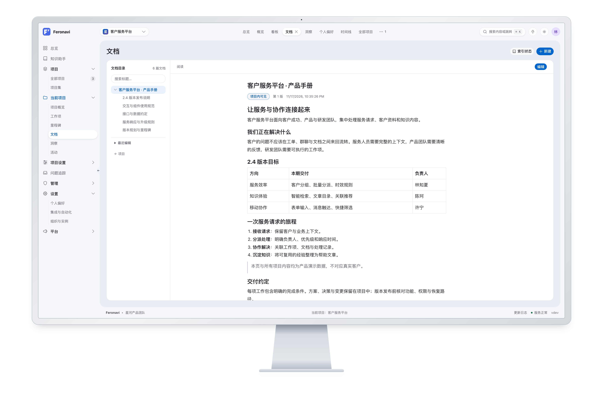

<a id="top"></a>

<div align="center">
  
  <h1>Feronavi</h1>
  <h3>Your team and agents, moving projects forward together.</h3>
  <p><strong>An open-source workspace connecting requirements, knowledge and delivery.</strong><br />Write together, get answers from your documents, and let agents move work forward.</p>
  <p>
    <a href="LICENSE"></a>
    <a href="#mcp"></a>
    <a href="#rag"></a>
    <a href="#collaboration"></a>
    <a href="#get-started"></a>
  </p>
  <p>
    <strong><a href="#get-started">Deploy Feronavi</a></strong> ·
    <a href="#overview">Highlights</a> ·
    <a href="#collaboration">Collaboration</a> ·
    <a href="#mcp">Connect an agent</a> ·
    <a href="#feedback">Feedback</a>
  </p>
  <p><a href="README.md">简体中文</a> / <strong>English</strong></p>
</div>

<picture>
  <source media="(prefers-color-scheme: dark)" srcset="docs/screenshots/01-workbench-dark.png" />
  <source media="(prefers-color-scheme: light)" srcset="docs/screenshots/10-workbench-light.png" />
  
</picture>

<p align="center"><sub>Product preview · Demo data · Light / dark</sub> · <a href="#more-views">More views&nbsp;→</a></p>

<a id="overview"></a>

## From the first idea to the next release.

From breaking down requirements and planning iterations to writing proposals and shipping releases, Feronavi brings project work into one workspace. Teams collaborate in the platform, agents act with real project context, and accumulated knowledge is ready to search and cite.

| Core capability | What it makes possible |
| --- | --- |
| **Complete MCP server** | Let agents read context, perform business operations and verify results |
| **Built-in RAG assistant** | Search across projects, answer with current business context and follow citations to the source |
| **Live collaboration** | Edit together, merge changes automatically and sync after a brief disconnection |
| **Your deployment** | Keep data in your environment and choose your models and identity systems |

<a id="mcp"></a>

## A complete MCP server. Put your agent in the delivery loop.

**Read context. Take action. Verify the outcome.** Agents can create work items, change assignments and states, maintain documents, and manage iterations and releases, then read the data back to confirm what happened.

For example, you can ask an agent to prepare a release:

> Review unfinished work in this iteration and identify release risks. Propose changes first. After my confirmation, update assignments and states, prepare the release documentation, and verify the results.

The server provides MCP **tools, resources and prompts**, with **Streamable HTTP and stdio** access. Codex, Claude Desktop, Cursor, VS Code and other MCP-compatible clients can connect through the standard protocol and dynamically discover the capabilities each task needs.

The platform UI, built-in assistant and MCP share business services, permissions and audit rules. Agent actions are bound by account permissions and token scopes, with idempotent execution and version conflict handling.

[**Connect your MCP client →**](packages/feronavi-mcp/README.md)

<a id="rag"></a>

## Built-in RAG. Put your project knowledge to work.

**Turn the documents you've built up into answers you can use now.** The dedicated assistant works across projects or focuses on a selected project, combining document retrieval with current business information in one conversation.

> Why was this requirement designed this way? Use the design documents and current iteration to review the risks for this release, and include your sources.

- **Answers with sources.** Follow references to the original material, within project and document access rules.
- **Conversations that flow.** Streamed responses, Markdown, Mermaid diagrams and multiple conversations saved to your account on the server.
- **Analysis that leads to action.** Queries run directly; business changes are presented for your confirmation, then executed and verified.

Configure compatible chat and embedding models to use the assistant. Retrieval and Q&A are also available to external applications through MCP and public APIs.

<a id="rag-integration"></a>

<details>
<summary>Connect RAG: models, MCP and APIs</summary>

1. **Use it in the platform.** Configure chat and embedding models, publish the project documents you want to search, and confirm indexing is complete. Then select a project scope in the assistant and ask a question.
2. **Use it through an agent.** Follow the [MCP setup guide](packages/feronavi-mcp/README.md), then use `rag.projects` to list accessible projects, `rag.search` to retrieve material and `rag.chat` for answers with citations.
3. **Connect your application.** Get the OpenAPI 3.1 description from your instance at `GET /api/v1/openapi.json`. Authenticate with a platform API token using Bearer authentication. Use `POST /api/v1/rag/search` for retrieval and `POST /api/v1/rag/chat` for Q&A; the description includes request and response schemas, conversations and streaming endpoints.

The OpenAPI description covers the public RAG API. Retrieval and citations respect the current identity, the token's project scope and document permissions.

</details>

<a id="collaboration"></a>

## Write together. Move the project forward together.

Refine a proposal, capture a discussion or prepare a delivery handbook together, while an agent organizes work items and moves the iteration forward.

- **Edit together.** Write in the same project document, merge changes automatically, and review or restore earlier revisions.
- **Keep writing through a disconnection.** Continue editing a document that has already loaded. Changes are saved in the current browser, then synced and merged when the connection returns.
- **Coordinate with agents.** Business changes follow shared permission and version rules. Conflicts are reported explicitly, so the person or agent making the change can check the latest state before retrying.
- **Stay up to date.** Business changes and in-app notifications update automatically across browser tabs and service instances.

<details>
<summary>How collaboration and offline recovery work</summary>

Document content uses Yjs CRDT to merge concurrent edits. Structured operations such as work items, scheduling and approvals use version checks, idempotent execution, transactions and events emitted after commit. Synchronization and notifications respect access permissions.

Opening a document for the first time requires a connection. Offline edits are saved in the current browser; recovery after closing the page requires local storage to be available. These records cannot be retained if the browser disables both IndexedDB and localStorage.

</details>

## Built for the full delivery cycle

From today's tasks to the next release, each step has a view that fits the work.

| Part of the work | Platform capabilities |
| --- | --- |
| **Capture and break down** | Ideas, requirements, tasks, defects and subtasks, with discussions and attachments |
| **Plan and deliver** | Milestones, iterations and releases; boards, tables, calendars and timelines |
| **Document and hand over** | Collaborative document editing, offline recovery, navigation, revision history, permissions and rollback |
| **Coordinate and automate** | Custom workflows, approvals, automation, SLAs and in-app notifications |
| **Review and oversee** | Personal workbench, burndown, cumulative flow, portfolios and audit records |

<picture>
  <source media="(prefers-color-scheme: dark)" srcset="docs/screenshots/04-wiki-dark.png" />
  <source media="(prefers-color-scheme: light)" srcset="docs/screenshots/11-wiki-light.png" />
  
</picture>

## Capabilities backed by real execution

Concurrent editing and offline recovery, business operations through a real Codex client, and Docker deployment with backup and restore have all been exercised. The automation scripts ship with the source so you can repeat the checks in your environment.

<details>
<summary>See the validation scope</summary>

- **Collaboration checks:** Concurrent editing, offline recovery, synchronization across tabs and service instances, and permission isolation.
- **Agent checks:** MCP business workflows, action confirmation, idempotent execution and reading back persisted results, also exercised through a real Codex client.
- **Deployment checks:** Fresh Docker installations, service restarts, backup and restore, and matching build artifacts between source and container images.

These checks validate business behavior and data consistency. Task planning and interaction in each client depend on its MCP support and the model it uses.

</details>

## Open source. Your deployment.

Run it in your own environment, with your own model providers and identity systems. Roles and data scopes govern access; OIDC, LDAP / AD, 2FA and SCIM 2.0 connect to the way your team manages accounts.

Chinese and English interfaces, light and dark themes, and email, IM, webhooks and third-party integrations you can configure as needed.

<a id="get-started"></a>

## Get started

With Docker Compose installed, run these commands from the source root to build and start a new instance from the current checkout:

```bash
# First installation: create a local database password
(umask 077; test -e .env || echo "DB_PASSWORD=$(openssl rand -hex 24)" > .env)

docker compose -f compose.yaml -f compose.source.yaml up -d --build
docker compose -f compose.yaml -f compose.source.yaml ps
```

Once the services are ready, open [http://127.0.0.1:3000/setup](http://127.0.0.1:3000/setup) to create your organization and administrator. The first build compiles database extensions and can take some time.

> This branch's collaboration updates have not yet been released as prebuilt images. Use the source build above to try them.

For production, put the instance behind an HTTPS reverse proxy. Before upgrading an existing instance, back up the database and data volume and review the database image's migration requirements.

For your first project, start here:

1. Create a project, invite teammates and break your first requirement into work items.
2. Publish a project document, follow the [RAG setup instructions](#rag-integration) to complete indexing, and ask the assistant a question that needs a cited source.
3. Create an API token, follow the [MCP setup guide](packages/feronavi-mcp/README.md) to connect an agent, and ask it to review progress and suggest the next step.

<a id="documentation"></a>

## Integration and help

| I want to… | Start here |
| --- | --- |
| **Deploy and operate** | [Installation and first-run setup](#get-started) |
| **Connect an agent** | [MCP client configuration and access](packages/feronavi-mcp/README.md) |
| **Integrate knowledge and chat** | [Model setup, RAG tools and public APIs](#rag-integration) |
| **Report a security issue** | [Security reporting instructions](SECURITY.md) |

<a id="more-views"></a>

## More views

<details>
<summary>Explore project overviews, delivery insights, timelines and themes</summary>

| Projects and delivery | Workspace and appearance |
| --- | --- |
| [Project board](docs/screenshots/03-board.png) | [Knowledge assistant](docs/screenshots/12-assistant.png) |
| [Project overview](docs/screenshots/02-project-overview.png) | [All projects](docs/screenshots/09-projects.png) |
| [Iteration insights](docs/screenshots/05-insights.png) | [Personal preferences](docs/screenshots/07-settings.png) |
| [Delivery timeline](docs/screenshots/08-timeline.png) | [Sign-in page](docs/screenshots/06-login.png) |
| [Dark workbench](docs/screenshots/01-workbench-dark.png) | [Dark document reader](docs/screenshots/04-wiki-dark.png) |

Screenshots use fictional teams and business data in a dedicated demo environment. Transparent backgrounds and custom, unbranded frames accompany the main screenshots, which follow your light or dark reading theme.

</details>

<a id="feedback"></a>

## Feedback and license

Issues are welcome for bug reports and suggestions. The project is developed and maintained by its owner and does not currently accept Pull Requests. Please follow the [security reporting instructions](SECURITY.md) for vulnerabilities instead of disclosing details in a public issue.

Feronavi is licensed under [AGPL-3.0-only](LICENSE).

[Back to top ↑](#top)
